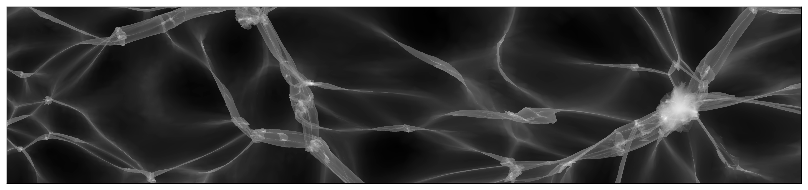

# PhaseSpaceDTFE
[](https://jfeldbrugge.github.io/PhaseSpaceDTFE.jl/stable/)
[](https://jfeldbrugge.github.io/PhaseSpaceDTFE.jl/dev/)
[](https://github.com/jfeldbrugge/PhaseSpaceDTFE.jl/actions/workflows/CI.yml?query=branch%3Amain)
[](https://codecov.io/github/jfeldbrugge/PhaseSpaceDTFE.jl)


<figure>
<a href='docs/src/assets/figures/density.png'></a>
</figure>

The density and velocity fields of an N-body simulation are estimated with the Phase-Space Delaunay Tessellation Field Estimator implemented in Julia. This code accompanies the publication [Phase-Space Delaunay Tesselation Field Estimator](https://academic.oup.com/mnras/article/536/1/807/7915986).

## Installation

The PhaseSpaceDTFE package can be installed with the Julia package manager.
From the Julia REPL, type `]` to enter the Pkg REPL mode and run:

```julia
pkg> add PhaseSpaceDTFE
```

Or, equivalently, via the `Pkg` API:

```julia
julia> using Pkg; Pkg.add("PhaseSpaceDTFE")
```

## Usage
Given the initial (`coords_q`) and final (`coords_x`) particle positions and the velocities `vels` of an $N$-body simulation in a periodic box of size `L` with `Ni`³ particles, we estimate the density, velocity and number-of-streams fields as follows:

```julia
using PhaseSpaceDTFE

m       = 1.  # particle mass, or a vector with the mass of every particle
sim_box = SimBox(L, Ni)

ps_dtfe = PS_DTFE(coords_q, coords_x, vels, m, sim_box)

density([x, y, z], ps_dtfe)            # density at a point, summed over the streams
numberOfStreams([x, y, z], ps_dtfe)
velocity([x, y, z], ps_dtfe)           # one row per stream
velocitySum([x, y, z], ps_dtfe)        # stream-density weighted mean velocity

xs = range(0, L, length = 257)
density_field  = density_grid(xs, xs, xs, ps_dtfe)          # array indexed [ix, iy, iz]
nstreams_field = numberOfStreams_grid(xs, xs, xs, ps_dtfe)
density_field, nstreams_field = ps_dtfe_grid(coords_q, coords_x, m, sim_box, xs, xs, xs)   # without storing an estimator
```

Options include the tessellation of the initial positions (`tessellation = :delaunay` (default) or `:kuhn` for lattice initial conditions), the vertex densities (`vertex_density = :mass` (default) or `:lagrangian`), and estimators without periodic boundaries (`periodicity = :nonperiodic`). Start Julia with several threads (`julia -t auto`) to compute grids in parallel.

Version 2 is a rewrite of the estimator: it is about ten times faster to construct, point queries are about 60 times faster, and fields on grids are computed by rasterisation. The sub-box estimators and `DTFE_periodic` of version 1 have been removed; see the migration page of the documentation.

Please have a look at the Documentation for more details.

## Contributors
This code was written by:
* Job Feldbrugge ([job.feldbrugge@ed.ac.uk](mailto:job.feldbrugge@ed.ac.uk))
* Benjamin Hertzsch ([benjamin.hertzsch@ed.ac.uk](mailto:benjamin.hertzsch@ed.ac.uk))

We thank:
* Bram Alferink


## Citations
When using this code in work, please cite

```
@article{Feldbrugge2024,
    author = {Feldbrugge, Job},
    title = {Phase-space Delaunay tessellation field estimator},
    journal = {Monthly Notices of the Royal Astronomical Society},
    volume = {536},
    number = {1},
    pages = {807-815},
    year = {2024},
    month = {12},
    issn = {0035-8711},
    doi = {10.1093/mnras/stae2627},
    url = {https://doi.org/10.1093/mnras/stae2627},
    eprint = {https://academic.oup.com/mnras/article-pdf/536/1/807/61019429/stae2627.pdf},
}

@misc{FeldbruggeHertzsch2025,
  author = {Feldbrugge, Job and Hertzsch, Benjamin},
  title = {PhaseSpaceDTFE.jl -- Julia implementation of the Phase-Space Delaunay Tessellation Field Estimator},
  year = {2025},
  month = {aug},
  doi = {10.5281/zenodo.16637561},
  url = {http://dx.doi.org/10.5281/zenodo.16637561}
}
```

and the additional references listed in the citation section of the documentation.
