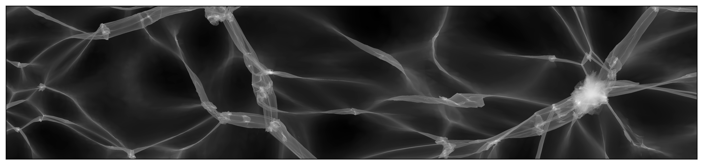

```@meta
CurrentModule = PhaseSpaceDTFE
```

# Phase-Space DTFE

Documentation for [PhaseSpaceDTFE](https://github.com/jfeldbrugge/PhaseSpaceDTFE.jl).



The density, velocity and number-of-streams fields of a three-dimensional $N$-body simulation are estimated with the Phase-Space Delaunay Tessellation Field Estimator (PS-DTFE). This code accompanies the publication [Phase-Space Delaunay Tessellation Field Estimator](https://academic.oup.com/mnras/article/536/1/807/7915986).

## Installation

The PhaseSpaceDTFE package can be installed with the Julia package manager.
From the Julia REPL, type `]` to enter the Pkg REPL mode and run:

```julia
pkg> add PhaseSpaceDTFE
```

Or, equivalently, via the `Pkg` API:

```julia
julia> import Pkg; Pkg.add("PhaseSpaceDTFE")
```

## Usage
Given the initial (`coords_q`) and final (`coords_x`) particle positions and the velocities `vels` of an $N$-body simulation in a periodic box of size `L` with `Ni`³ particles, we estimate the density, velocity and number-of-streams fields as follows:

```julia
using PhaseSpaceDTFE

m       = 1.  # particle mass, or a vector with the mass of every particle
sim_box = SimBox(L, Ni)

ps_dtfe = PS_DTFE(coords_q, coords_x, vels, m, sim_box)

density([x, y, z], ps_dtfe)            # density at a point, summed over the streams
numberOfStreams([x, y, z], ps_dtfe)
velocity([x, y, z], ps_dtfe)           # one row per stream
velocitySum([x, y, z], ps_dtfe)        # stream-density weighted mean velocity

xs = range(0, L, length = 257)
density_field  = density_grid(xs, xs, xs, ps_dtfe)          # array indexed [ix, iy, iz]
nstreams_field = numberOfStreams_grid(xs, xs, xs, ps_dtfe)
density_field, nstreams_field = ps_dtfe_grid(coords_q, coords_x, m, sim_box, xs, xs, xs)   # without storing an estimator
```

Start Julia with several threads (`julia -t auto`) to compute grids in parallel. Please have a look at the [Tutorial](tutorial.md) for more details.

## What is new in version 2

Version 2 is a rewrite of the estimator:

* **Tessellations.** The periodic Delaunay tessellation of the initial positions (`tessellation = :delaunay`, default) works for lattice, glass and other initial conditions. For lattice initial conditions, the Kuhn split of the particle lattice (`tessellation = :kuhn`) gives every particle the same star of 24 tetrahedra.
* **Vertex densities.** Besides the classical DTFE estimate (`vertex_density = :mass`), the Lagrangian estimate (`vertex_density = :lagrangian`) is exact for a uniform initial density, also for irregular tessellations and zoom simulations with particles of different mass.
* **Periodic boundaries.** Every tetrahedron is unwrapped across the box on its own, so particles may travel around the box any number of times.
* **Non-periodic estimator.** `PS_DTFE(...; periodicity = :nonperiodic)` estimates the fields without periodic boundary conditions.
* **Point location.** A uniform cell index with the precomputed inverse edge matrix of every tetrahedron replaces the bounding volume hierarchy. Point queries do not allocate.
* **Grids.** `density_grid`, `numberOfStreams_grid` and `ps_dtfe_grid` evaluate the fields on regular grids by rasterising the tetrahedra. `ps_dtfe_grid` replaces the sub-box estimators of version 1 for simulations whose estimator does not fit in memory.

On the 64³ test simulation (`test/data`), compared with version 1:

| | v1 | v2 |
|---|---|---|
| construction | 20–70 s | 3–8 s |
| point query (random points) | 820–890 µs | 14 µs with `G = Ni` (283 MB); 5.7 µs with `G = 2Ni` (573 MB) |
| 257² slice | 126 s | 0.56 s |
| 257³ grid | ≈ 4 h by point queries (estimated) | 2.7 s (8 threads); 3.7 s without an estimator |

See [Migrating from version 1](migration.md) for the changes to the interface.

## Contributors
This code was written by:
* Job Feldbrugge ([job.feldbrugge@ed.ac.uk](mailto:job.feldbrugge@ed.ac.uk))
* Benjamin Hertzsch ([benjamin.hertzsch@ed.ac.uk](mailto:benjamin.hertzsch@ed.ac.uk))

We thank:
* Bram Alferink
