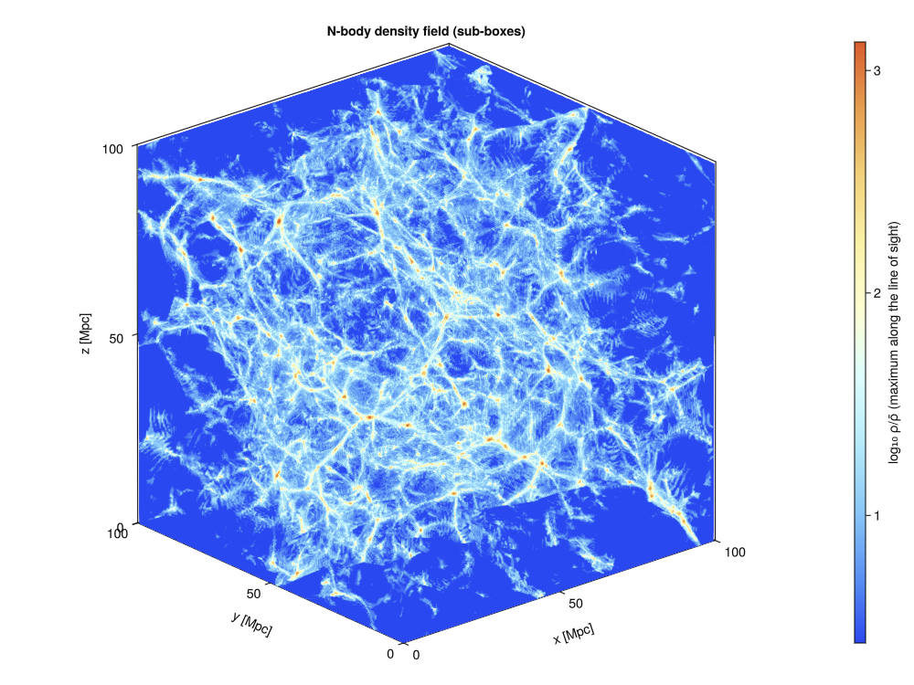

```@meta
CurrentModule = PhaseSpaceDTFE
```

# Tutorial

In this tutorial, we demonstrate the usage of the *PhaseSpaceDTFE.jl* package to estimate the density and velocity fields from a *GADGET-4* simulation with 64³ particles.

We start by importing the relevant libraries and loading the data:

```@example tutorial1
using HDF5, Statistics, PhaseSpaceDTFE
import Plots   # imported, as Plots also exports a function `density`

## set up simulation box
Ni = 64
L  = 100.
sim_box = SimBox(L, Ni)   ## need this for estimator creation

## load data
function load_data(file)
    fid = h5open(file, "r")
    pos = convert.(Float64, read(fid["PartType1"]["Coordinates"]))
    vel = convert.(Float64, read(fid["PartType1"]["Velocities"]))
    ids = read(fid["PartType1"]["ParticleIDs"])
    time = read_attribute(fid["Header"], "Time")
    close(fid)

    ordering = sortperm(ids)
    return (copy(pos[:,ordering]'), copy(vel[:,ordering]'), time)
end

function load_mass(file)
    f = h5open(file, "r")
    read_attribute(f["Header"], "MassTable")[2]  # particle type 1
end

m = load_mass("../../test/data/snapshot_000.hdf5")
(coords_q, _, _) = load_data("../../test/data/snapshot_000.hdf5")
(coords_x, vels, _) = load_data("../../test/data/snapshot_002.hdf5")
nothing
```

The particle coordinates and velocities are `Float64` matrices of size `(N, 3)`, with one row per particle and the rows of `coords_q`, `coords_x` and `vels` in the same order. The particle mass `m` is a single number, or a vector of length `N` for simulations whose particle masses differ.

## Prequel: Delaunay Tessellation Field Estimator

Before going through the PS-DTFE method, we demonstrate the traditional DTFE method by calling the PS-DTFE code on the final (*Eulerian*) particle positions only.

```@example tutorial1
## construct estimator
dtfe = PS_DTFE(coords_x, coords_x, vels, m, sim_box)

## evaluate density field
Range = 0:0.2:100.
density_field = [density([L/2., y, z], dtfe) for y in Range, z in Range]
Plots.heatmap(Range, Range, log10.(density_field), aspect_ratio=:equal, xlims=(0, L), ylims=(0, L), c=:lighttemperaturemap, xlabel="[Mpc]", ylabel="[Mpc]")
```

## Phase-Space Delaunay Tessellation Field Estimator

The estimator is constructed once from the initial (*Lagrangian*) and final (*Eulerian*) positions, `coords_q` and `coords_x`, and the velocities `vels`:

```@example tutorial1
## construct estimator
ps_dtfe = PS_DTFE(coords_q, coords_x, vels, m, sim_box)

## if want to ignore velocities
# ps_dtfe = PS_DTFE(coords_q, coords_x, m, sim_box)
nothing
```

`PS_DTFE` tessellates the initial positions in the periodic box, computes the density at every particle from the volumes of the evolved tetrahedra around it, and builds a cell index for the point location. This takes a few seconds for a 64³ simulation and needs about 1.1 kB of memory per particle (0.3 GB for 64³ particles, about 2.3 GB for 128³).

We now evaluate the density field with the `density()`-function:

```@example tutorial1
# evaluate density field
density_field = [density([L/2., y, z], ps_dtfe) for y in Range, z in Range]
Plots.heatmap(Range, Range, log10.(density_field), aspect_ratio=:equal, xlims=(0, L), ylims=(0, L), c=:lighttemperaturemap, xlabel="[Mpc]", ylabel="[Mpc]")
```

The corresponding number of streams is evaluated with the `numberOfStreams()`-function:

```@example tutorial1
nstreams_field = [numberOfStreams([L/2., y, z], ps_dtfe) for y in Range, z in Range]
Plots.heatmap(Range, Range, nstreams_field, aspect_ratio=:equal, xlims=(0, L), ylims=(0, L), clim=(1, 7), c=:lighttemperaturemap, xlabel="[Mpc]", ylabel="[Mpc]")
```

Points are taken modulo the box. Similarly, the velocity field is evaluated with the `velocity()`-function:

```@example tutorial1
velocity([L/2., L/2., L/2.], ps_dtfe)
```

In multistream regions, the `velocity()`-function returns the velocities of the individual streams, one row per stream (or `[NaN NaN NaN]` if `single_stream=true` is passed as the third argument). To obtain the stream-density weighted mean of the velocities, call the `velocitySum()`-function, which reduces to the `velocity()`-function in single-stream regions.

```@example tutorial1
velocitySum([L/2., L/2., L/2.], ps_dtfe)
```

The function `inSimplices()` returns the indices of the stored tetrahedra containing a point; `ps_dtfe.simplices[i, :]` are the rows of the particles at their corners.

## Fields on a grid

Grids give fields most efficiently: `density_grid()` and `numberOfStreams_grid()` rasterise the tetrahedra, instead of locating every grid point, and return arrays indexed `[ix, iy, iz]`. The values equal the point queries at the grid points, bit for bit, and the grid may extend beyond the box:

```@example tutorial1
Range = -10:0.5:100.
density_field = density_grid(Range, Range, Range, ps_dtfe)
Plots.heatmap(Range, Range, log10.(density_field[length(Range) ÷ 2, :, :]), aspect_ratio=:equal, xlims=(-10, L), ylims=(-10, L), c=:lighttemperaturemap, xlabel="[Mpc]", ylabel="[Mpc]")
```

```@example tutorial1
nstreams_field = numberOfStreams_grid(Range, Range, Range, ps_dtfe)
Plots.heatmap(Range, Range, nstreams_field[length(Range) ÷ 2, :, :], aspect_ratio=:equal, xlims=(-10, L), ylims=(-10, L), clim=(1, 7), c=:lighttemperaturemap, xlabel="[Mpc]", ylabel="[Mpc]")
```

Every axis of a grid is its own range, with its own spacing, extent and number of points; within an axis the spacing is uniform. A slice is a grid with a single point along one axis, in any orientation, and costs about as much as the tetrahedra that cross it:

```@example tutorial1
Range = 0:0.2:100.
s = L/2:L/2
slice_x = density_grid(s, Range, Range, ps_dtfe)[1, :, :]
slice_y = density_grid(Range, s, Range, ps_dtfe)[:, 1, :]
slice_z = density_grid(Range, Range, s, ps_dtfe)[:, :, 1]
Plots.plot(
    Plots.heatmap(Range, Range, log10.(slice_x), aspect_ratio=:equal, c=:lighttemperaturemap, xlims=(0, L), ylims=(0, L), title="x = L/2", xlabel="[Mpc]", ylabel="[Mpc]"),
    Plots.heatmap(Range, Range, log10.(slice_y), aspect_ratio=:equal, c=:lighttemperaturemap, xlims=(0, L), ylims=(0, L), title="y = L/2", xlabel="[Mpc]", ylabel="[Mpc]"),
    Plots.heatmap(Range, Range, log10.(slice_z), aspect_ratio=:equal, c=:lighttemperaturemap, xlims=(0, L), ylims=(0, L), title="z = L/2", xlabel="[Mpc]", ylabel="[Mpc]");
    layout = (1, 3), size = (1500, 450))
```

A slab with a different spacing along each axis gives, for example, the mean density through a 20 Mpc thick layer:

```@example tutorial1
xs, ys, zs = 0:0.2:100., 0:0.4:100., 40:1.:60.
slab = density_grid(xs, ys, zs, ps_dtfe)                                  # array of size (501, 251, 21)
slab_mean = dropdims(sum(slab; dims = 3); dims = 3) ./ length(zs)
Plots.heatmap(ys, xs, log10.(slab_mean), aspect_ratio=:equal, xlims=(0, L), ylims=(0, L), c=:lighttemperaturemap, xlabel="y [Mpc]", ylabel="x [Mpc]", title="mean density for 40 < z < 60 Mpc")
```

The threads split the z-planes of a grid; start Julia with `julia -t auto` to use them. Grid values are point samples of the estimator. Near caustics, where the density concentrates in thin multistream regions, the grid integral of the density converges to the total mass only as the grid refines; the integral of the estimator itself equals the total mass exactly.

## Large simulations: sub-boxes

A simulation with 512³ or 1024³ particles has a tessellation too large to keep in memory. The sub-box routines cut the box into `N_sub`³ sub-boxes, build the estimator of one sub-box at a time, rasterise it into the grid and release it. Every sub-box takes its particles with a frame of `pad` lattice spacings (default 5) and their periodic images, and keeps the tetrahedra whose centroid lies in its core. With `parallel = k` the routines build k sub-box estimators concurrently, at k times the memory of one; the grids do not depend on k.

`PS_DTFE_subbox` builds the estimators once and saves them to a directory, from which the grid routines read them back:

```@example tutorial1
N_sub, parallel = 2, 2
ps_dtfe_sb = PS_DTFE_subbox(coords_q, coords_x, vels, m, sim_box; N_sub, parallel, dir = mktempdir())
nothing
```

The sub-box versions of the grid routines take the same grids. A slice:

```@example tutorial1
Range = 0:0.2:100.
density_field = density_grid_sb(L/2:L/2, Range, Range, ps_dtfe_sb; parallel)[1, :, :]
Plots.heatmap(Range, Range, log10.(density_field), aspect_ratio=:equal, xlims=(0, L), ylims=(0, L), c=:lighttemperaturemap, xlabel="[Mpc]", ylabel="[Mpc]")
```

```@example tutorial1
number_field = numberOfStreams_grid_sb(L/2:L/2, Range, Range, ps_dtfe_sb; parallel)[1, :, :]
Plots.heatmap(Range, Range, number_field, aspect_ratio=:equal, xlims=(0, L), ylims=(0, L), clim=(1, 7), c=:lighttemperaturemap, xlabel="[Mpc]", ylabel="[Mpc]")
```

The grid equals the point queries of the sub-box estimators, summed over the sub-boxes:

```@example tutorial1
Range_check = 0:2.:100.
points = [[L/2, y, z] for y in Range_check, z in Range_check]
density_points = zeros(size(points))
PhaseSpaceDTFE.foreach_subbox(ps_dtfe_sb; parallel) do est
    density_points .+= density.(points, Ref(est))
end
density_grid_sb(L/2:L/2, Range_check, Range_check, ps_dtfe_sb; parallel)[1, :, :] ≈ density_points
```

`rasterise_sb` returns the density and the number of streams together. `Float32` densities and `UInt16` stream counts take 6 instead of 16 bytes per grid point:

```@example tutorial1
Range = -10:1.:100.
density_field, number_field = rasterise_sb(Range, Range, Range, ps_dtfe_sb; parallel, density_type = Float32, streams_type = UInt16)
Plots.heatmap(Range, Range, log10.(density_field[length(Range) ÷ 2, :, :]), aspect_ratio=:equal, xlims=(-10, L), ylims=(-10, L), c=:lighttemperaturemap, xlabel="[Mpc]", ylabel="[Mpc]")
```

A three-dimensional view of the density needs volume rendering, which GLMakie provides (CairoMakie cannot draw volumes). A maximum-intensity projection shows the densest point along every line of sight, so its colour range comes from the maxima along a line of sight; a range from the voxels themselves would saturate the image:

```julia
import GLMakie
GLMakie.activate!()

Range3D = range(0, L, length = 257)[1:end-1]                         # the periodic cell [0, L)³
ρ̄ = m * Ni^3 / L^3
δlog = log10.(density_grid_sb(Range3D, Range3D, Range3D, ps_dtfe_sb; parallel, density_type = Float32) ./ ρ̄)
vmin, vmax = quantile(vec(maximum(δlog; dims = 3)), (0.02, 0.998))
extent = (first(Range3D), last(Range3D))

fig = GLMakie.Figure(size = (1000, 750))
ax = GLMakie.Axis3(fig[1, 1]; title = "N-body density field (sub-boxes)", aspect = :equal,
                   limits = (0, L, 0, L, 0, L), xlabel = "x [Mpc]", ylabel = "y [Mpc]", zlabel = "z [Mpc]")
vol = GLMakie.volume!(ax, extent, extent, extent, δlog; colormap = :lighttemperaturemap, algorithm = :mip,
                      colorrange = (vmin, vmax), interpolate = true)
GLMakie.Colorbar(fig[1, 2], vol; label = "log₁₀ ρ/ρ̄ (maximum along the line of sight)")
display(GLMakie.Screen(), fig)                                        # an interactive window
```



## Velocities of the streams

`velocity_grid_sb` (and `velocity_grid` for a single estimator) gives the velocity and the density of every stream at every grid point. With `deformation = true` it also stores the divergence, the shear tensor and the vorticity of every stream, from the velocity gradient of its tetrahedron:

```@example tutorial1
Range = 0:1.:100.
G = velocity_grid_sb(Range, Range, Range, ps_dtfe_sb; parallel, velocity_type = Float32, deformation = true)
nothing
```

At the grid point with the most streams, `G[ix, iy, iz]` gives the velocity of every stream, one row per stream:

```@example tutorial1
ix, iy, iz = Tuple(argmax(G.nstreams))
G.nstreams[ix, iy, iz], G[ix, iy, iz]
```

```@example tutorial1
stream_density(G, ix, iy, iz), stream_divergence(G, ix, iy, iz)
```

The stream-density weighted mean of the x-velocity in a slice, as `velocitySum`, and the spread of the x-velocity between the streams, which vanishes in single-stream regions:

```@example tutorial1
ix = length(Range) ÷ 2
vx_mean = [(ρ = stream_density(G, ix, iy, iz); isempty(ρ) ? NaN : sum(ρ .* G[ix, iy, iz][:, 1]) / sum(ρ)) for iy in eachindex(Range), iz in eachindex(Range)]
vx_spread = [(V = G[ix, iy, iz]; isempty(V) ? NaN : maximum(V[:, 1]) - minimum(V[:, 1])) for iy in eachindex(Range), iz in eachindex(Range)]
Plots.plot(
    Plots.heatmap(Range, Range, vx_mean, aspect_ratio=:equal, xlims=(0, L), ylims=(0, L), c=:lighttemperaturemap, xlabel="[Mpc]", ylabel="[Mpc]", title="mean vx [km/s]"),
    Plots.heatmap(Range, Range, vx_spread, aspect_ratio=:equal, xlims=(0, L), ylims=(0, L), c=:lighttemperaturemap, xlabel="[Mpc]", ylabel="[Mpc]", title="spread of vx between streams [km/s]");
    layout = (1, 2), size = (1100, 450))
```

## Velocity deformation

`stream_average(G, field)` gives the density-weighted mean over the streams of `:velocity`, `:divergence`, `:shear` (the components xx, yy, zz, xy, xz and yz) or `:vorticity`, the grid counterparts of `velocitySum`, `divergenceSum`, `shearSum` and `vorticitySum`:

```@example tutorial1
divergence_field = stream_average(G, :divergence)[ix, :, :]
vorticity_field  = stream_average(G, :vorticity)[ix, :, :, :]
shear_field      = stream_average(G, :shear)[ix, :, :, :]
vorticity_norm   = sqrt.(sum(abs2, vorticity_field; dims = 3))[:, :, 1]
shear_norm       = sqrt.(shear_field[:, :, 1].^2 .+ shear_field[:, :, 2].^2 .+ shear_field[:, :, 3].^2 .+
                         2 .* (shear_field[:, :, 4].^2 .+ shear_field[:, :, 5].^2 .+ shear_field[:, :, 6].^2))
Plots.plot(
    Plots.heatmap(Range, Range, divergence_field, aspect_ratio=:equal, xlims=(0, L), ylims=(0, L), c=:lighttemperaturemap, xlabel="[Mpc]", ylabel="[Mpc]", title="mean ∇·v"),
    Plots.heatmap(Range, Range, log10.(vorticity_norm), aspect_ratio=:equal, xlims=(0, L), ylims=(0, L), c=:lighttemperaturemap, xlabel="[Mpc]", ylabel="[Mpc]", title="log10 |mean ω|"),
    Plots.heatmap(Range, Range, log10.(shear_norm), aspect_ratio=:equal, xlims=(0, L), ylims=(0, L), c=:lighttemperaturemap, xlabel="[Mpc]", ylabel="[Mpc]", title="log10 |mean σ|");
    layout = (1, 3), size = (1500, 450))
```

Vorticity arises through shell crossing, so for a continuous flow it vanishes in single-stream regions. The estimator interpolates the particle velocities linearly, so its single-stream vorticity reflects the discreteness of the particles. The typical (median) vorticity in single- and multistream regions of the slice:

```@example tutorial1
single = G.nstreams[ix, :, :] .== 1
median(filter(isfinite, vorticity_norm[single])), median(filter(isfinite, vorticity_norm[.!single]))
```

## Sub-boxes on the fly

Without saving the estimators, the grid routines build the sub-boxes from the particles, `parallel` at a time, rasterise them and release them in turn. The grid does not depend on `parallel`, only the time and the memory do:

```@example tutorial1
Range = -10:1.:100.
density_one = density_grid_sb(Range, Range, Range, coords_q, coords_x, m, sim_box; N_sub, parallel = 1)
density_field = density_grid_sb(Range, Range, Range, coords_q, coords_x, m, sim_box; N_sub, parallel)
density_field == density_one
```

For the Kuhn split, `ps_dtfe_grid()` computes the density and the number of streams on a grid directly from the particles, with the tetrahedra generated on the fly from the lattice; it needs only the particles, their densities and the grid:

```julia
density_field, nstreams_field = ps_dtfe_grid(coords_q, coords_x, m, sim_box, Range, Range, Range)   # tessellation = :kuhn by default
```

## Options

`PS_DTFE` and `PS_DTFE_periodic` accept the following keyword arguments:

* `tessellation`: the tessellation of the initial positions.
  * `:delaunay` (default): the periodic Delaunay tessellation, for lattice, glass or other initial conditions. The positions are tessellated together with their periodic images within a frame of width `pad * L` (by default four mean particle spacings). A small `jitter` (default `1e-5` mean particle spacings) splits degenerate configurations, such as an exact lattice, consistently across the periodic images. TetGen tessellates `slabs` slabs of the box concurrently (by default one per thread); together they give the tetrahedra of a single tessellation.
  * `:kuhn`: the Kuhn (Freudenthal) split of the particle lattice, for lattice initial conditions with `Ni`³ particles. Every cube of the lattice is split into the six tetrahedra that share its main diagonal, so every particle has the same star of 24 tetrahedra, and the estimator is exact for affine maps. The lattice site of every particle follows from its initial position, so the rows may come in any order.
* `vertex_density`: the density at the particles.
  * `:mass` (default): ``\rho_i = 4 m_i / V(W_i)``, from the Eulerian volume of the star ``W_i`` of the particle. Valid for any particle masses.
  * `:lagrangian`: ``\rho_i = \bar\rho\, V_L(W_i) / V(W_i)``, with the Lagrangian volume ``V_L`` of the star. It assumes a uniform initial density and is then exact, also when the stars differ in size (glass initial conditions, the Delaunay tessellation) or the masses vary with the resolution (zoom simulations). Recommended with `:delaunay`.
  For the Kuhn split with equal masses both choices coincide, and both conserve the total mass.
* `G`: the number of cells per side of the search index (default `Ni`). A larger `G` gives faster point queries at the cost of memory.
* `compact = true`: the estimator recomputes the first corner and the inverse edge matrix of every tetrahedron at every query instead of storing them, with identical results, at a third of the memory and slower point queries.

```@example tutorial1
kuhn = PS_DTFE(coords_q, coords_x, vels, m, sim_box; tessellation = :kuhn)
density_field = density_grid(L/2:L/2, 0:0.2:100., 0:0.2:100., kuhn)[1, :, :]
Plots.heatmap(0:0.2:100., 0:0.2:100., log10.(density_field), aspect_ratio=:equal, xlims=(0, L), ylims=(0, L), c=:lighttemperaturemap, xlabel="[Mpc]", ylabel="[Mpc]")
```

## Without periodic boundaries

With `periodicity = :nonperiodic` (or `PS_DTFE_nonperiodic`), the estimator uses the Delaunay tessellation of the initial positions without periodic images, and takes query points as given, not modulo the box. The final positions are taken at the periodic image nearest to the initial positions, so a particle that truly moves more than L/2 along an axis lands at the wrong image. The thin tetrahedra on the convex hull of the initial positions (with two corners more than three lattice spacings apart along an axis) are removed; pass `drop_simplices = false` to keep them. The tetrahedra cover the convex hull of the particles, so points between the hull and the faces of the box have density zero, and with `vertex_density = :mass` the densities near the hull come out high; `vertex_density = :lagrangian` avoids this bias. Away from the faces the estimator equals the periodic one:

```@example tutorial1
nonperiodic = PS_DTFE(coords_q, coords_x, vels, m, sim_box; periodicity = :nonperiodic)
density([L/2., L/2., L/2.], nonperiodic), density([L/2., L/2., L/2.], ps_dtfe)
```
